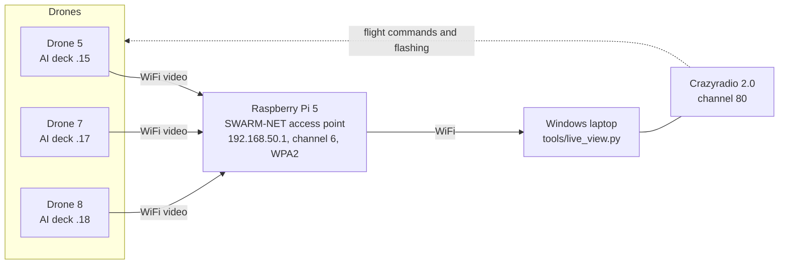

# Handover: AI-deck video network for the Crazyflie swarm

State on 2026-11-10. This guide explains what was built, how to use it, how to add a drone, what to expect,
and how to undo it. The step-by-step rebuild with every command is in [docs/speedrun.md](docs/speedrun.md);
the open work is in [TODO.md](TODO.md).

## 1. In one paragraph

The project goal is five Crazyflies with AI decks flying in the OptiTrack volume, streaming camera frames that
are turned into a 3D map and compared between two runs (spec: [docs/spec.md](docs/spec.md)). Out of the box,
every AI deck creates its own WiFi network, so a laptop can only watch one deck at a time. This work moves the
decks onto **one shared network, SWARM-NET, run by a Raspberry Pi 5**, so the laptop receives all cameras at
once. Three drones (5, 7, 8) are converted and stream live side by side in one window at about 8 frames per
second each. Flight control is unchanged: it still goes over the Crazyradio.

## 2. How it fits together



- **Video path:** camera (GAP8 chip, JPEG 324x244) -> WiFi chip (ESP32) -> SWARM-NET -> laptop, TCP port 5000.
- **Radio path:** laptop -> Crazyradio -> drone. Used for flight and for flashing the deck firmware.
- The laptop currently joins SWARM-NET over WiFi, so it has **no internet** while watching the decks.
  A Pi Ethernet link is planned (TODO).

## 3. Facts and addresses

| Item | Value |
|---|---|
| Access point | Raspberry Pi 5, Raspberry Pi OS Lite 64-bit (Debian 13), NetworkManager profile `swarm-ap` |
| Network | SSID `SWARM-NET`, WPA2, channel 6 (2.4 GHz), 192.168.50.1/24, autoconnect on boot |
| Passphrase | Not written anywhere in this repository. Ask the person who set it up. |
| Pi login | `ssh -o PreferredAuthentications=password swarm-pi@192.168.50.1` (user name is lowercase) |
| Pi settings changed | WiFi power save off (persisted in `swarm-ap`); fixed DHCP addresses in `/etc/NetworkManager/dnsmasq-shared.d/decks.conf` (copy of [config/pi/decks.conf](config/pi/decks.conf)) |
| Deck addresses | `192.168.50.1<body id>`: drone 5 = .15, drone 7 = .17, drone 8 = .18 |
| Hardware | Crazyflie 2.x with Crazyflie firmware 2026.10, AI deck 1.1 (GAP8 + ESP32, Himax camera) |
| Radio | Crazyradio 2.0, URI `radio://0/80/2M/E7E7E7E7E<body id>`; the last digit of the address is the body id |
| Drone list | [config/drones.yaml](config/drones.yaml) (address, radio, deck_ip, optional camera_rotation) |

## 4. What was changed on the hardware

| Drone | Camera chip (GAP8) | WiFi chip (ESP32) | Status |
|---|---|---|---|
| 7 | station image, built **before** the camera fix | official 2025.02 | Works: 8 fps, 0 drops in the last test. Reflash GAP8 with the current build when convenient. |
| 8 | station image with camera fix | official 2025.02 | Works: 8.4 fps, 0 drops in the last test. |
| 5 | station image with camera fix | official 2025.02 (verify) | Works, but had one 10 s drop right after start. Re-check the ESP32 flash. |
| 4 | unchanged (professor's access-point build, network `aideck_4`) | unchanged | cfloader cannot see the deck over the radio, so nothing was flashed. |
| others | unchanged (professor's build, network `aideck<N>`) | unchanged | Not touched. |

Everything is reversible except the ESP32 version: the old one cannot be read back, but the official 2025.02 also
runs the access-point (lab) mode, so the lab use is not affected (section 9).

## 5. Laptop setup (once)

Windows, PowerShell. Details: [docs/speedrun.md](docs/speedrun.md) Part B.
1. `python -m pip install --user cfclient opencv-python numpy pyyaml`
   - Do **not** run `pip install cfloader`: that is an unrelated package that breaks cfclient's flasher.
   - The flasher is `& "$env:APPDATA\Python\<PythonXY>\Scripts\cfloader.exe"` (not on PATH).
2. Crazyradio driver with Zadig: **libusb-win32**, not WinUSB (with WinUSB cflib says "Cannot find a Crazyradio Dongle").
3. Docker Desktop with the `bitcraze/aideck` image, only needed to build the camera firmware.
4. Check: `python -m unittest tests.test_swarm` -> 7 tests OK.

## 6. Daily use

1. Drones on (props off for bench tests). Each deck needs about **20 s** after power-on to join SWARM-NET.
2. Laptop WiFi -> **SWARM-NET**.
3. From the repository folder:
   ```powershell
   python tools\live_view.py
   ```
   One tile per drone that has a `deck_ip` in `config/drones.yaml`.
   - Left-click a tile: flip the picture 180 degrees. Right-click: turn 90 degrees. On exit it prints the
     rotations to keep (`camera_rotation:` in drones.yaml).
   - `q`/Esc quit, `s` screenshot to `snapshots/`, `+`/`-` zoom.
   - Tile messages: `CONNECTING...` = deck not reachable; `CONNECTED, NO VIDEO YET` = deck on the network but
     no pictures; `NO VIDEO 3.2s` = was streaming, now silent (it reconnects by itself).
   - Every run writes an event log `logs/live_view_<date>_<time>.txt` (connects, stalls, drops, summary).
   - `--save recordings\run1` also keeps every frame; `--deck cf9=192.168.50.19` shows a deck not in the config.
4. Pass/fail numbers: `python tools\stream_test.py --seconds 60` (target per deck: at least 1 fps, 0 reconnects).
5. Drones off when done (the AI deck drains the small battery quickly).

## 7. What to expect

| Topic | Normal behaviour |
|---|---|
| Frame rate | About 8 fps per deck, 324x244 grayscale JPEG, 4-5 KB per frame (about 40 KB/s per deck) |
| Start-up | About 20 s from power-on to the first frame. The camera fix can add up to 5 s. |
| Drops | Occasional single drop: about 10 s without frames, then the deck rejoins by itself. Seen mostly in the first minute. The viewer reconnects automatically. |
| Picture orientation | Can come out upside down depending on the deck. Fix with a click, then make it permanent in drones.yaml. |
| Battery | A tired battery shows up as a deck that joins the network but stalls. Swap batteries before judging a deck. |
| Laptop | No internet while on SWARM-NET. |
| Ping times | 30-800 ms to a deck is normal (the ESP32 saves power between packets); video still flows. |
| Measured | Last 3-deck run, 66 s: drone 7 8.15 fps 0 drops, drone 8 8.39 fps 0 drops, drone 5 6.98 fps 1 drop. Deck 7 alone: 1044 frames in 137 s. Raw logs: [docs/evidence/2026-11-10](docs/evidence/2026-11-10/README.md). |

## 8. Adding a drone (about 10 minutes)

Example for body id N (radio address `E7E7E7E7EN`). Full commands with checks: [docs/speedrun.md](docs/speedrun.md) Part D.
1. **Flash the camera chip** with the station image (built once for all decks, Part C).
   The output must contain `100% writing to bcAI:gap8 deck memory`.
2. **Flash the WiFi chip** with `firmware/esp32/aideck_esp_2025.02_official.bin` (`deck-bcAI:esp-fw`).
   The output must contain `100% writing to bcAI:esp deck memory`.
   If cfloader ends with no "writing" and no "Skipping bcAI" line, it did **not** see the deck and flashed nothing (drone 4).
3. **Power-cycle** the drone. The camera chip gives the network name and key to the WiFi chip only at power-on.
4. **Find its MAC:** on SWARM-NET, read the Pi log; the new deck is the line named `espressif`:
   `ssh ... swarm-pi@192.168.50.1 "journalctl --since '-15min' --no-pager | grep -i 'DHCPACK.*espressif'"`
5. **Fixed address:** add `dhcp-host=<MAC>,192.168.50.1N,deckN` to `config/pi/decks.conf` and
   `deck_ip: "192.168.50.1N"` to the drone in `config/drones.yaml`, then install on the Pi with the two
   commands in Part D step 5 (the second must print `Running timer as unit`). SWARM-NET restarts briefly.
6. Power-cycle the decks, run `python tools\live_view.py`.

Limits in `config/drones.yaml`: body ids 1-9, at most 3 drones per Crazyradio (`radio_index`).

## 9. Putting a deck back into lab mode (its own network, e.g. `aideck7`)

Only the camera chip changes; the official ESP32 firmware serves both modes.
- Quick: flash `firmware/gap8/ap-backup_aideck_2.img` to `deck-bcAI:gap8-fw` (network name `aideck_2`,
  open network, deck at 192.168.4.1, without the camera fix).
- Per-deck name: in `wifi-img-streamer.c` change `"aideck_2"` in the `#else` branch of `setupWiFi()` to the
  deck's name, build **without** `WIFI_STATION=1`, flash `gap8-fw`. Speedrun Part F.
- Not yet tested on a deck (see TODO). The old `capture.py` then works as before.

## 10. Building the camera firmware

[docs/speedrun.md](docs/speedrun.md) Part C. Summary: clone `bitcraze/aideck-gap8-examples` at commit 5fd95ca,
copy `firmware/gap8/wifi-img-streamer.c` and `Makefile` into `examples/other/wifi-img-streamer/`, create
`wifi_credentials.h` with the real passphrase, then:
```powershell
docker run --rm -v "${PWD}:/module" bitcraze/aideck tools/build/make-example examples/other/wifi-img-streamer image SETUP_WIFI_AP=1 WIFI_STATION=1
```
What the three code changes are: [firmware/README.md](firmware/README.md).

## 11. Troubleshooting (most common)

| Symptom | Fix |
|---|---|
| `Cannot find a Crazyradio Dongle` | Zadig driver libusb-win32, close cfclient |
| SSH `Permission denied` | User is lowercase `swarm-pi` |
| Tile `CONNECTING...` | Laptop not on SWARM-NET, deck not joined yet (wait 20 s / power-cycle), or fixed address not installed (`ping 192.168.50.1N`) |
| Tile `CONNECTED, NO VIDEO YET` | Camera did not start: flash the current GAP8 build (has the fix), check the battery |
| Stalls of ~10 s every minute, deck rejoining (Pi log DISCONNECTED/CONNECTED) | Old ESP32 firmware: flash the official 2025.02 |
| cfloader prints no "writing" line | Drone did not report the deck; nothing flashed (check `deck.bcAI` parameter and firmware version in cfclient) |
Full table: [docs/speedrun.md](docs/speedrun.md#troubleshooting-all-seen-on-2026-11-10).

## 12. Security notes

- The SWARM-NET passphrase is only in `wifi_credentials.h` (git-ignored) and inside every built station image
  (`BUILD/`, git-ignored). Do not commit or share either.
- During the first SWARM-NET setup a trial passphrase was typed into an AI chat. If it is still the one in use,
  change it (TODO B): new key on the Pi (`sudo nmcli con modify swarm-ap wifi-sec.psk '<new>'`), edit
  `wifi_credentials.h`, rebuild the station image and reflash `gap8-fw` on every converted deck.
- The Pi password was set during bring-up and should be changed (`passwd` on the Pi) before others use the lab.
- Anyone on SWARM-NET can reach the decks' video port; keep the passphrase within the project.

## 13. Lessons learned (save time next time)

1. The decks' **old ESP32 firmware** caused the drops in station mode; the official 2025.02 release fixed it.
   Turning off power saving (Pi or my own ESP32 build) did not help and is not needed.
2. **cfloader can skip a deck silently.** Always check for the `100% writing` line.
3. The stock camera program can **give up on the camera** after one failed register read (WiFi up, no video):
   fixed in our build.
4. **Zadig: libusb-win32**, not WinUSB, for cflib on Windows.
5. **Never `pip install cfloader`** (name clash with an unrelated package).
6. The camera chip sends the WiFi settings **only at power-on**: power-cycle after flashing.
7. Linux user names are case-sensitive: `swarm-pi`, not `Swarm-Pi`.
8. While on SWARM-NET the laptop has no internet; save outputs to files and read them later.

## 14. Repository map

| Path | Content |
|---|---|
| [TODO.md](TODO.md) | Open issues and roadmap |
| [docs/speedrun.md](docs/speedrun.md) | Full rebuild, every command |
| [docs/journal.md](docs/journal.md) | Day-by-day log with all measurements and decisions |
| [docs/pi-ap-setup.md](docs/pi-ap-setup.md) | Pi access point details (incl. planned Ethernet link) |
| [docs/deck-station-mode.md](docs/deck-station-mode.md) | How station mode works, per-deck procedure |
| [docs/spec.md](docs/spec.md), [docs/tasks.md](docs/tasks.md) | Project spec and phased plan |
| [docs/legacy-analysis.md](docs/legacy-analysis.md) | Notes on the course code (IA-in-Robotica), not included here |
| [docs/evidence/](docs/evidence/2026-11-10/README.md) | Raw test logs |
| `tools/live_view.py` | Live multi-deck viewer + event log |
| `tools/stream_test.py` | FPS / drop measurement, pass/fail |
| `swarm/` | Config loader, deck stream reader, mocap pose hub, simulator |
| `tests/` | Unit tests (simulation only) |
| `config/` | drones.yaml, Pi fixed addresses |
| `firmware/` | Camera source changes, official ESP32 binary, lab-mode image |

Not included: the course flight scripts (`legacy_scripts/IA-in-Robotica`), recordings, the Bitcraze examples
checkout (cloned on demand) and anything containing the passphrase.
